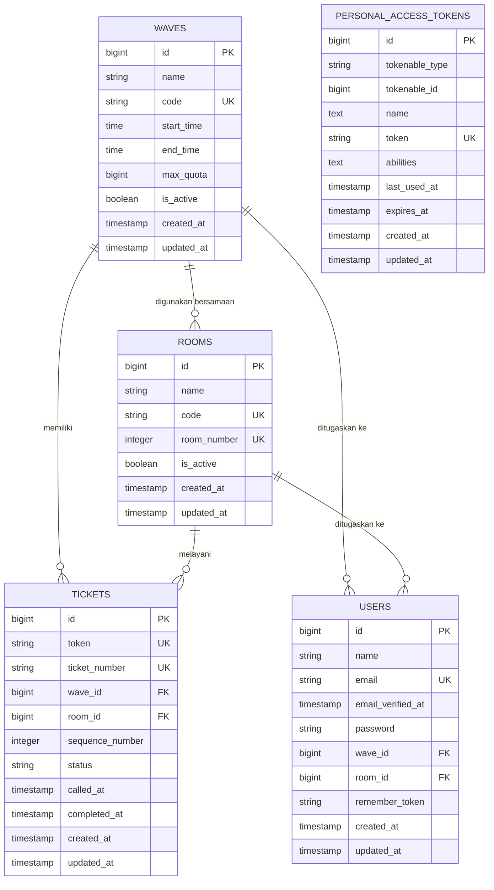

# Pembuatan Website Antrian ( Web-DosQueue-V1 )

Dikarenakan ini masih tahap pertama dalam pengembangan website aplikasi antrian. Kami baru memiliki beberapa alur, seperti ini
 
- Alur Guest / Pengunjung
    Guest -> Frontend Website -> Backend API (Laravel) -> Controller -> Validasi dan Logika Sistem -> Database (MariaDB) -> Backend API (Laravel) -> Frontend Website -> Guest menerima nomor tiket dan token

- Alur Staff / Petugas
    Staff -> Frontend Website -> Backend API (Laravel) -> Middleware (Autentikasi dan Otorisasi) -> Controller -> Validasi dan Logika Antrian (FIFO) -> Database (MariaDB) -> Backend API (Laravel) -> Frontend Website -> Staff melihat dan mengelola antrian.

- Alur Pemanggilan dan Penyelesaian Tiket

    Staff -> Frontend Website -> Backend API (Laravel) -> Middleware -> Controller -> Validasi Hak Akses dan Status Tiket -> Pemanggilan Tiket (WAITING menjadi CALLED) -> Database (MariaDB) -> Backend API (Laravel) -> Frontend Website -> Staff melakukan pelayanan.

    Staff -> Frontend Website -> Backend API (Laravel) -> Controller -> Validasi Status Tiket -> Penyelesaian Pelayanan (CALLED menjadi COMPLETED) -> Database (MariaDB) -> Backend API (Laravel) -> Frontend Website -> Staff melihat konfirmasi tiket selesai.

- Alur Live Queue Monitor

    Frontend Website -> Backend API (Laravel) -> Controller -> Mengambil Data Antrian Terbaru -> Database (MariaDB) -> Backend API (Laravel) -> Response JSON -> Frontend Website -> Memperbarui Tampilan Antrian (Short Polling 3–5 Detik).

## Kenapa menggunakan Backend API dilaravel??
Penggunaan backend API atau REST API (JSON) pada project ini dikarenakan alasan teknis yang sangat krusial untuk cara kerja sistem antrian.

Dengan menggunakan API(JSON), halaman web cukup mengirim permintaan kecil di latar belakang (background request via JavaScript fetch) setiap 4 detik ke /api/tickets/{token}/monitor dan hanya mengambil data teks yang berubah. Dan Jika tidak menggunakan API (melainkan halaman web tradisional), seluruh halaman HTML harus dimuat ulang dari awal setiap 4 detik, yang membuat layar berkedip, boros kuota/server, dan merusak pengalaman pengguna.

### Dan ada alasan lain, kenapa kita memakai API <br>

Penggunaan Backend API atau REST API (JSON) pada project ini bertujuan untuk memisahkan proses pengolahan data dari tampilan website.

Dengan REST API, frontend dapat mengirim permintaan ke backend menggunakan JavaScript Fetch tanpa harus memuat ulang seluruh halaman. Contohnya, pada fitur Live Queue Monitor, frontend mengirim permintaan setiap 3–5 detik ke endpoint pemantauan antrian untuk mendapatkan data terbaru.

Backend kemudian mengambil data yang diperlukan dari database dan mengirimkannya kembali dalam format JSON. Frontend hanya memperbarui bagian tampilan yang mengalami perubahan.

Pendekatan ini membuat komunikasi antara frontend dan backend lebih fleksibel, efisien, dan mudah dikembangkan.


## Tech 
Kami sepakat menggunakan <b>LARAVEL</b>. Karena
<ol>
<li>Struktur kode terorganisasi</li>
<p>Laravel memiliki pemisahan Route, Controller, Model, Middleware, dan Migration. Hal ini membuat setiap proses memiliki tanggung jawab masing-masing sehingga kode lebih mudah dikembangkan, diperiksa, dan dipelihara.</p>

<li>Mempermudah pembuatan REST API</li>
<p>Laravel mendukung pembuatan REST API dengan response JSON sehingga frontend dapat berkomunikasi dengan backend untuk mengirim permintaan dan menerima data secara terstruktur.</p>

<li>Mendukung autentikasi dan otorisasi</li>
<p>Antiran memiliki dua jenis aktor, yaitu Guest dan Staff. Laravel menyediakan mekanisme autentikasi dan middleware untuk melindungi endpoint petugas serta membatasi akses berdasarkan gelombang dan ruangan yang ditugaskan.</p>

<li>Mempermudah validasi data</li>
<p>Laravel menyediakan fitur validasi request untuk memastikan data yang masuk sesuai dengan aturan sistem. Contohnya, memeriksa ketersediaan kuota gelombang, validitas tiket, dan perubahan status tiket.</p>

<li>Mendukung transaksi database</li>
<p>Antiran memiliki proses penting seperti pengambilan tiket, pembagian ruangan, dan pengelolaan kuota. Laravel mendukung database transaction dan locking untuk membantu mencegah ketidaksesuaian data ketika beberapa pengunjung mengambil tiket secara bersamaan.</p>

<li>Mempermudah pengelolaan database</li>
<p>Laravel menyediakan Eloquent ORM, Migration, dan Seeder untuk mengelola tabel, relasi antartabel, serta data awal tanpa harus mengatur semuanya secara manual.</p>

<li>Mudah dikembangkan dan dipelihara</li>
<p>Struktur Laravel memungkinkan penambahan fitur baru tanpa harus membangun ulang keseluruhan backend. Hal ini memudahkan pengembangan Antiran apabila nantinya membutuhkan fitur tambahan.</p>
</ol>

## Struktur Folder

| Folder / File | Keterangan |
|---|---|
| `app/` | Berisi logika utama aplikasi Laravel. |
| `app/Http/Controllers/` | Mengatur alur permintaan, validasi, dan respons. |
| `app/Models/` | Berisi model dan relasi database. |
| `bootstrap/` | Berisi proses bootstrap aplikasi Laravel. |
| `config/` | Berisi konfigurasi aplikasi, database, mail, dan layanan lain. |
| `database/migrations/` | Berisi definisi struktur tabel database. |
| `database/seeders/` | Berisi data awal atau data uji untuk database. |
| `database/factories/` | Berisi pembuat data uji secara otomatis. |
| `public/` | Folder publik yang dapat diakses browser, seperti CSS, JavaScript, dan gambar. |
| `resources/views/` | Berisi file template tampilan. |
| `resources/css/` | Berisi file CSS sumber. |
| `resources/js/` | Berisi file JavaScript sumber. |
| `routes/web.php` | Mendefinisikan route untuk halaman web. |
| `routes/api.php` | Mendefinisikan route untuk API. |
| `storage/` | Menyimpan cache, log, session, serta file hasil upload. |
| `tests/` | Berisi pengujian aplikasi. |
| `vendor/` | Berisi dependensi yang dipasang oleh Composer. |
| `.env` | Berisi konfigurasi lingkungan lokal, seperti database dan aplikasi. |
| `composer.json` | Daftar dependensi PHP dan konfigurasi Composer. |
| `package.json` | Daftar dependensi JavaScript dan skrip frontend. |
| `artisan` | Perintah CLI Laravel untuk menjalankan tugas aplikasi. |

### Lokasi File Utama

- Controller antrean: `app/Http/Controllers/`
- Model antrean dan pengguna: `app/Models/`
- Halaman frontend: `resources/views/`
- CSS dan JavaScript: `resources/css/` dan `resources/js/`
- Route halaman: `routes/web.php`
- Route API: `routes/api.php`
- Migrasi database: `database/migrations/`
- Data awal database: `database/seeders/`
- Konfigurasi aplikasi: `config/`
- File publik: `public/`
- File upload dan log: `storage/`

## Struktur Database

Database yang digunakan adalah **MariaDB**, dikelola menggunakan Laravel Migration dan Eloquent ORM.

### Diagram Relasi



## Pembagian tugas tim 

| Nama Anggota | Peran (Role) |
| :--- | :--- |
| **Izzan Afresetya** | Project Initiator & Concept Developer |
| **Mochammad Khahfi** | Lead Backend & Application Developer |
| **Muhammad Rizky Apriadi** | UI/UX Asset Designer |
| **Noval Aqiransyah R. M.** | Visual Asset Designer |
| **Tegar Permana Putra** | Concept & UI/UX Designer |

### Penjelasan tugasnya
1. Project Initiator & Concept Developer (Izzan)

   Bertanggung jawab dalam menginisiasi project, mengembangkan gagasan awal, mematangkan konsep, serta memberikan arahan mengenai tujuan dan gambaran sistem yang akan dibuat.

2. Lead Backend & Application Developer (Kahfi)

   Bertanggung jawab dalam menerjemahkan konsep dan rancangan sistem menjadi aplikasi yang berfungsi melalui proses pemrograman, pengembangan backend, integrasi fitur, dan implementasi logika sistem.

3. UI/UX Asset Designer (Iky)

   Bertanggung jawab dalam mencari, mengumpulkan, dan menentukan aset visual yang digunakan dalam website, seperti ikon, palet warna, ilustrasi, gambar, dan elemen estetika lainnya.

4. Visual Asset Designer (Noval)

   Bertanggung jawab dalam membantu pencarian dan penyediaan aset visual, memberikan referensi elemen desain, serta mendukung kebutuhan estetika dan konsistensi visual website.

5. Concept & UI/UX Designer (Tegar)

   Bertanggung jawab dalam membantu pematangan konsep, memberikan referensi dan inspirasi desain, serta menyusun gambaran tata letak website melalui wireframe agar struktur tampilan lebih terarah.

## Tahap pengerjaan tim kami
- ### Diskusi Ide
    Kami memulai project ini dengan berdiskusi semua tim, tujuannya agar website yang kami buat berfungsi dan memiliki identitas bahwa website yg kita buat adalah website ciptaan tim kami, bukan AI. 
    dan juga ada beberapa orang yang sangat penting ditahap pertama ini. Yaitu izzan dan tegar, Izzan berperan sebagai penginisiasi project yang mengembangkan ide awal menjadi konsep yang lebih matang dan Tegar turut membantu memberikan masukan, inspirasi, dan gambaran mengenai bentuk website yang akan dibuat.

    - Hasil Tahap ini adalah `Ide awal, tujuan project, konsep sistem, dan gambaran fitur utama Antiran`

- ### Mencari masalah dan menganalisis kebutuhan website
    Setelah ide sudah terkumpul, lanjut untuk membahas masalah yang ada, seperti kebutuhan website, menentukan fitur yang diperlukan, jenis pengguna, serta alur kerja sistem. Tahap ini bertujuan agar website memiliki struktur navigasi dan pengalaman pengguna yang jelas.
    
    - Hasil Tahap ini adalah `Spesifikasi kebutuhan sistem, alur logika, dan rancangan fitur website`

- ### Perancangan UI/UX dan Wireframe
    Tegar membantu memetakan struktur tampilan website melalui wireframe, menentukan tata letak komponen, serta memberikan referensi desain. Tahap ini bertujuan agar website memiliki struktur navigasi dan pengalaman pengguna yang jelas.

    - Hasil Tahap ini adalah `Wireframe, rancangan layout, dan referensi tampilan website`

- ### Pengumpulan dan Pemilihan Aset Visual
    Iky dan Noval mulai mencari, mengumpulkan, serta menentukan berbagai kebutuhan visual website, seperti ikon, palet warna, gambar, ilustrasi, font, dan elemen dekoratif lainnya.

    - Hasil Tahap ini adalah `Kumpulan aset visual dan pedoman estetika website`

- ### Implementasi dan Pengembangan Website
    Kahfi mulai menerjemahkan rancangan dan spesifikasi yang telah disepakati menjadi kode program. Proses ini mencakup pembuatan struktur website, implementasi tampilan, pengembangan backend, pengelolaan database, serta integrasi fitur-fitur Antiran.

    - Hasil Tahap ini adalah `Website Antiran yang memiliki tampilan dan fungsi sesuai rancangan`

- ### Pengujian Backend dan API (API Testing)
    Setelah backend selesai dikembangkan, dilakukan pengujian terhadap setiap endpoint API menggunakan Postman atau Thunder Client. Pengujian ini bertujuan memastikan bahwa setiap fungsi backend berjalan sesuai spesifikasi, komunikasi API berhasil, serta proses penyimpanan dan pengambilan data dari database berjalan dengan benar.

    Pengujian meliputi autentikasi Staff, pengambilan tiket Guest, validasi kuota, pembagian ruangan (Round-Robin), pengelolaan antrian (FIFO), perubahan status tiket, dan pemantauan antrian.

    Selain itu, dilakukan pemeriksaan terhadap struktur tabel, relasi database, konsistensi data, serta kemungkinan kesalahan ketika beberapa request dilakukan secara bersamaan.

    - Hasil Tahap ini adalah `Backend dan database telah diuji secara terpisah, kesalahan yang ditemukan telah diperbaiki, dan seluruh endpoint API siap untuk diintegrasikan dengan frontend`

- ### Integrasi Frontend dan Backend
    Setelah backend dan API dinyatakan berjalan sesuai kebutuhan, tahap selanjutnya adalah menghubungkan frontend dengan backend melalui REST API. Pada tahap ini, setiap interaksi pengguna pada frontend mulai dihubungkan dengan endpoint yang telah dibuat.

    - Hasil Tahap ini adalah Frontend dan backend terintegrasi sehingga fitur website dapat bekerja menggunakan data dari database.

- ### Pengujian dan Evaluasi Sistem
    Setelah integrasi selesai, dilakukan pengujian secara menyeluruh terhadap website dari sisi pengguna. Pengujian mencakup tampilan, navigasi, interaksi Guest dan Staff, serta keseluruhan proses antrian dari pengambilan tiket hingga pelayanan selesai.

    - Hasil Tahap ini adalah `Daftar kesalahan, evaluasi sistem, dan perbaikan fitur yang belum berjalan sesuai harapan`

- ### Penyempurnaan dan Finalisasi
    Tahap terakhir adalah melakukan penyempurnaan berdasarkan hasil pengujian dan evaluasi. Tim memastikan tampilan, fungsi, alur sistem, serta aset visual sudah sesuai dengan konsep awal sebelum website dinyatakan selesai.

    - Hasil Tahap ini adalah `Website Antiran versi final yang siap digunakan atau dipresentasikan`


### Ringkasan Tahap

```text
Inisiasi Ide
    ↓
Pengembangan Konsep
    ↓
Analisis Kebutuhan dan Logika Sistem
    ↓
Perancangan UI/UX dan Wireframe
    ↓
Implementasi dan Pengembangan Website
    ↓
Pengujian Backend dan API (API Testing)
    ↓
Integrasi Frontend dan Backend
    ↓
Pengujian dan Evaluasi Sistem
    ↓
Penyempurnaan dan Finalisasi
    ↓
Website Antiran Selesai
```

