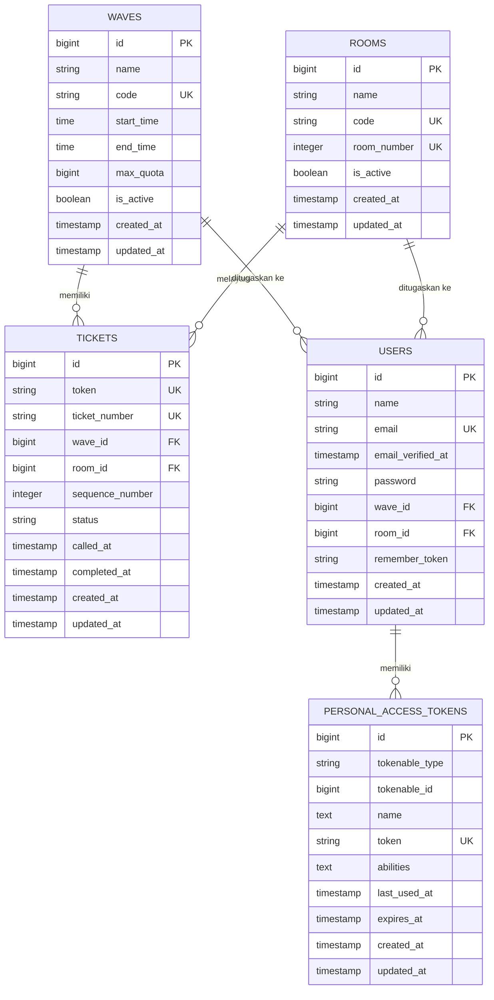

# Pembuatan Website Antrian ( Web-DosQueue-V1 )

## Ringkasan Proyek

Web-DosQueue-V1 adalah aplikasi antrean berbasis Laravel. Aplikasi menggunakan halaman Blade untuk tampilan, JavaScript `fetch` untuk berkomunikasi dengan REST API berformat JSON, Sanctum untuk token akses petugas, dan MariaDB/MySQL sebagai basis data.

Proyek ini sudah memiliki alur utama berikut:

| Bagian | Fitur yang tersedia | Lokasi utama |
|---|---|---|
| Pengunjung | Melihat gelombang dan kuota, mengambil tiket, memeriksa tiket aktif, melihat detail tiket, dan memantau antrean. | `resources/views/guest/`, `app/Http/Controllers/Api/Guest/` |
| Petugas | Login, melihat antrean ruangan, memanggil tiket, menyelesaikan pelayanan, melihat riwayat, dan menghapus tiket dari riwayat. | `resources/views/staff/`, `app/Http/Controllers/Api/Staff/` |
| Aturan antrean | Pembagian ruangan Round-Robin, pemanggilan FIFO, validasi status, pembatasan permintaan, dan pengecekan hak petugas atas tiket. | `app/Services/`, `app/Policies/`, `app/Http/Requests/` |
| Data | Gelombang, ruangan, tiket, akun petugas, serta token akses Sanctum. | `app/Models/`, `database/migrations/` |

Untuk memahami cara menyiapkan lingkungan dan membuat proyek Laravel dengan API, baca [Cara-Buat.md](Cara-Buat.md). Untuk menjalankan salinan proyek ini, ikuti bagian **Menyiapkan dan Menjalankan Proyek Ini** di dokumen tersebut.

Dari kode saat ini, halaman monitor pengunjung memperbarui informasi melalui short polling. Endpoint monitor tersedia dan dipanggil oleh halaman tiket; permintaan berkala mengambil data terbaru dari server.

### Teknologi Proyek

| Teknologi | Penggunaan |
|---|---|
| PHP 8.3 atau lebih baru | Bahasa backend; versi proyek saat ini dikembangkan dengan PHP 8.5. |
| Laravel 13 | Framework backend dan halaman Blade. |
| Laravel Sanctum 4 | Autentikasi token untuk endpoint petugas. |
| MariaDB atau MySQL | Penyimpanan data relasional. |
| JavaScript `fetch` | Mengirim permintaan API dari halaman web. |
| Node.js dan npm | Menjalankan Vite dan membangun aset frontend. |
| Vite 8 dan Tailwind CSS 4 | Perangkat build dan styling frontend. |

Versi dependensi PHP tercatat di `composer.json`; versi dependensi JavaScript tercatat di `package.json`.

## Gambaran Alur Sistem

Bagian ini menunjukkan alur utama antara pengunjung, petugas, frontend, API Laravel, dan database. Fitur yang sudah tersedia pada kode dirangkum pada tabel **Ringkasan Proyek** di atas.
 
- Alur Guest / Pengunjung
    Guest -> Frontend Website -> Backend API (Laravel) -> Controller -> Validasi dan Logika Sistem -> Database (MariaDB) -> Backend API (Laravel) -> Frontend Website -> Guest menerima nomor tiket dan token

- Alur Staff / Petugas
    Staff -> Frontend Website -> Backend API (Laravel) -> Middleware (Autentikasi dan Otorisasi) -> Controller -> Validasi dan Logika Antrian (FIFO) -> Database (MariaDB) -> Backend API (Laravel) -> Frontend Website -> Staff melihat dan mengelola antrian.

- Alur Pemanggilan dan Penyelesaian Tiket

    Staff -> Frontend Website -> Backend API (Laravel) -> Middleware -> Controller -> Validasi Hak Akses dan Status Tiket -> Pemanggilan Tiket (WAITING menjadi CALLED) -> Database (MariaDB) -> Backend API (Laravel) -> Frontend Website -> Staff melakukan pelayanan.

    Staff -> Frontend Website -> Backend API (Laravel) -> Controller -> Validasi Status Tiket -> Penyelesaian Pelayanan (CALLED menjadi COMPLETED) -> Database (MariaDB) -> Backend API (Laravel) -> Frontend Website -> Staff melihat konfirmasi tiket selesai.

- Alur Live Queue Monitor

    Frontend Website -> Backend API (Laravel) -> Controller -> Mengambil Data Antrian Terbaru -> Database (MariaDB) -> Backend API (Laravel) -> Response JSON -> Frontend Website -> Memperbarui Tampilan Antrian (Short Polling 3–5 Detik).

## Kenapa Menggunakan Backend API di Laravel?

Proyek ini menggunakan REST API dengan respons JSON agar halaman dapat meminta dan mengirim data tanpa memuat ulang seluruh dokumen HTML. Contohnya, halaman monitor mengirim permintaan `GET /api/tickets/{token}/monitor` setiap 4 detik melalui JavaScript `fetch`. Server mengirim data status tiket dan antrean dalam JSON, lalu halaman memperbarui tampilan tiket.

### Memisahkan Tampilan dan Pengolahan Data

Frontend bertugas menampilkan halaman dan mengirim permintaan. Backend Laravel memvalidasi permintaan, menjalankan aturan tiket dan antrean, berkomunikasi dengan database, lalu mengirim hasilnya sebagai JSON. Pemisahan ini membuat tiap bagian memiliki tugas yang jelas dan memudahkan pengembangan fitur.

## Alamat Penyimpanan API dan Cara Kerjanya

API pada proyek ini memiliki beberapa lokasi penyimpanan kode. Setiap lokasi memiliki tugas yang berbeda, mulai dari mendaftarkan alamat API, memproses permintaan, menjalankan aturan sistem, hingga mengirimkan data kembali ke frontend.

| Lokasi | Kegunaan |
|---|---|
| `routes/api.php` | Mendaftarkan alamat endpoint API dan menghubungkannya dengan controller yang menangani permintaan. |
| `app/Http/Controllers/Api/Guest/` | Menangani permintaan API untuk pengunjung, seperti melihat gelombang dan mengambil tiket. |
| `app/Http/Controllers/Api/Staff/` | Menangani login petugas dan pengelolaan antrean oleh petugas. |
| `app/Http/Requests/` | Memeriksa apakah data yang dikirim sudah memenuhi aturan, seperti memastikan `wave_id` wajib diisi dan valid. |
| `app/Services/` | Menjalankan proses utama sistem, seperti membuat tiket, mengatur pembagian ruangan, dan mengelola antrean. |
| `app/Http/Resources/` | Menentukan bentuk data yang dikirim kembali oleh API dalam format JSON. |
| `app/Models/` | Menjadi penghubung antara kode Laravel dan data pada tabel database. |

Alamat API merupakan pintu masuk untuk mengirim permintaan. Kode yang memproses permintaan disimpan di controller, service, request, dan resource. Data tiket dan petugas disimpan di database MariaDB/MySQL.

Alamat lengkap API mengikuti bentuk berikut:

```text
https://alamat-website-anda/api/alamat-endpoint
```

Bagian `https://alamat-website-anda` bergantung pada alamat server tempat aplikasi dijalankan. Karena itu, endpoint di bawah ditulis tanpa domain server.

### Daftar Alamat API

#### API untuk Pengunjung

| Metode | Endpoint | Kegunaan |
|---|---|---|
| `GET` | `/api/waves` | Mengambil daftar gelombang beserta informasi kuotanya. |
| `POST` | `/api/tickets` | Membuat tiket baru untuk gelombang yang dipilih. |
| `GET` | `/api/tickets/active` | Memeriksa apakah pengunjung masih memiliki tiket aktif. |
| `GET` | `/api/tickets/{token}` | Mengambil informasi tiket berdasarkan token unik. |
| `GET` | `/api/tickets/{token}/monitor` | Mengambil informasi terbaru untuk memantau status dan posisi antrean tiket. |

`{token}` adalah bagian alamat yang diganti dengan token unik milik tiket. Sebagai contoh, jika token tiket adalah `tkt_abc123`, alamat monitor menjadi `/api/tickets/tkt_abc123/monitor`.

#### API untuk Petugas

| Metode | Endpoint | Kegunaan |
|---|---|---|
| `POST` | `/api/staff/login` | Memeriksa email dan kata sandi petugas, lalu memberikan token akses. |
| `GET` | `/api/staff/me` | Mengambil informasi petugas yang sedang login. |
| `POST` | `/api/staff/logout` | Mengakhiri sesi dengan menghapus token akses yang sedang digunakan. |
| `GET` | `/api/staff/queues` | Mengambil antrean aktif untuk ruangan petugas. |
| `POST` | `/api/staff/tickets/{ticket}/call` | Memanggil tiket yang sedang menunggu. |
| `POST` | `/api/staff/tickets/{ticket}/complete` | Menandai pelayanan tiket sebagai selesai. |
| `GET` | `/api/staff/history` | Mengambil riwayat tiket yang sudah selesai. |
| `DELETE` | `/api/staff/tickets/{ticket}` | Menghapus tiket dari daftar riwayat. |

Endpoint petugas selain `/api/staff/login` memerlukan token akses. Token dikirim pada header setiap permintaan, seperti contoh berikut:

```text
Authorization: Bearer TOKEN_AKSES
```

### Cara Kerja API

API bekerja sebagai perantara komunikasi antara tampilan website (frontend) dan backend. Saat pengunjung atau petugas melakukan tindakan di website, JavaScript mengirim permintaan ke alamat API. Laravel menerima permintaan itu, memeriksa dan memproses datanya, lalu mengirimkan jawaban dalam format JSON. Tampilan website membaca jawaban tersebut dan memperbarui informasi yang terlihat.

Urutan kerja API secara umum adalah sebagai berikut:

1. **Pengguna melakukan tindakan** pada halaman, misalnya memilih gelombang atau menekan tombol “Ambil Tiket”.
2. **Frontend mengirim permintaan HTTP** ke endpoint yang sesuai. Permintaan dapat membawa data seperti `wave_id`, atau token melalui header.
3. **Route API** di `routes/api.php` mencocokkan metode dan alamat permintaan dengan controller yang tepat.
4. **Laravel memeriksa permintaan.** Pemeriksaan ini dapat mencakup validasi data, pembatasan jumlah permintaan, autentikasi, dan izin akses.
5. **Controller dan service menjalankan proses.** Contohnya, mengambil daftar antrean, membuat tiket, atau mengubah status tiket.
6. **Laravel membaca atau memperbarui database** sesuai proses yang diminta.
7. **API mengirim respons JSON** beserta kode status HTTP yang menunjukkan hasil permintaan.
8. **Frontend menggunakan respons tersebut** untuk menampilkan data atau pesan kepada pengguna.

Contohnya, ketika halaman meminta data gelombang, frontend mengirim `GET /api/waves`. Laravel mengambil data gelombang beserta jumlah tiketnya, lalu mengirimkannya dalam JSON. Frontend menggunakan data tersebut untuk menampilkan pilihan gelombang tanpa memuat ulang seluruh halaman.

### Alur API Pengunjung

#### 1. Menampilkan Gelombang dan Kuota

Ketika halaman pengambilan tiket dibuka, frontend mengirim permintaan berikut:

```http
GET /api/waves
```

Laravel mengambil data gelombang dan menghitung jumlah tiket yang sudah tercatat. Respons API juga memberi informasi apakah masih ada gelombang aktif dengan kuota tersedia. Frontend menggunakan data itu untuk menampilkan pilihan gelombang dan menentukan apakah pengunjung dapat mengambil tiket.

#### 2. Mengambil Tiket

Setelah memilih gelombang, frontend mengirim permintaan berikut:

```http
POST /api/tickets
Content-Type: application/json
```

Dengan isi JSON seperti berikut:

```json
{
  "wave_id": 1
}
```

Laravel memeriksa bahwa `wave_id` wajib diisi, berbentuk angka, dan merujuk pada gelombang yang tersedia. Sistem juga dapat menerima token tiket sebelumnya melalui header `X-Ticket-Token` atau kolom `current_token`. Jika token itu masih memiliki tiket aktif, API mengembalikan tiket yang sama agar pengunjung tidak memperoleh tiket aktif kedua.

Jika tiket baru perlu dibuat, sistem memeriksa gelombang dan kuotanya. Proses pembuatan dilakukan di dalam transaksi database agar kuota tetap konsisten ketika beberapa permintaan masuk dalam waktu berdekatan. Sistem kemudian menentukan nomor urut dan ruangan tiket dengan pembagian Round-Robin, membuat token unik, menyimpan tiket dengan status `WAITING`, lalu mengembalikan data tiket dalam JSON.

#### 3. Memeriksa Tiket Aktif

Frontend dapat memeriksa tiket aktif dengan mengirim:

```http
GET /api/tickets/active
```

Token pengunjung dapat dikirim melalui header `X-Ticket-Token` atau parameter URL `?token=...`. Jika masih ada tiket berstatus `WAITING` atau `CALLED`, API mengembalikan data tiket aktif. Jika tidak ada, respons menyatakan bahwa pengunjung dapat mengambil tiket baru.

#### 4. Melihat Detail Tiket

Untuk mengambil detail tiket, frontend mengirim:

```http
GET /api/tickets/{token}
```

Laravel mencari tiket berdasarkan token unik. Jika ditemukan, API mengirim informasi tiket. Jika tiket tidak ditemukan atau sudah dihapus, API mengirim respons `404` beserta pesan bahwa tiket tidak tersedia.

#### 5. Memantau Antrean

Halaman tiket mengirim permintaan secara berkala ke endpoint berikut:

```http
GET /api/tickets/{token}/monitor
```

Endpoint ini mengirim informasi ringkas, seperti status tiket, gelombang dan ruangan, nomor tiket yang sedang dilayani di ruangan tersebut, serta jumlah tiket `WAITING` yang berada di depan tiket pengunjung. Endpoint monitor memiliki pembatasan jumlah permintaan melalui rate limiter `queue-polling`.

Dengan pola **short polling**, frontend meminta data terbaru setiap beberapa detik, misalnya 3–5 detik. Setelah menerima respons, frontend memperbarui bagian status antrean yang berubah. Seluruh halaman tidak perlu dimuat ulang pada setiap pemeriksaan.

### Alur API Petugas

#### 1. Login dan Mendapatkan Token Akses

Petugas mengirim email dan kata sandi ke alamat berikut:

```http
POST /api/staff/login
Content-Type: application/json
```

Laravel memeriksa data login dan mencocokkan kata sandi dengan data akun. Jika login berhasil dan akun memiliki penugasan ruangan, API membuat token akses. Frontend menyimpan token tersebut untuk disertakan pada permintaan petugas selanjutnya.

Permintaan ke endpoint petugas yang dilindungi menyertakan token seperti berikut:

```text
Authorization: Bearer TOKEN_AKSES
```

Laravel menggunakan autentikasi Sanctum untuk memeriksa token. Jika token tidak valid atau tidak disertakan, permintaan ke endpoint yang dilindungi tidak dapat diproses sebagai permintaan petugas yang sudah login.

#### 2. Mengambil Antrean Ruangan

Frontend petugas meminta daftar antrean dengan:

```http
GET /api/staff/queues
Authorization: Bearer TOKEN_AKSES
```

Laravel mengambil tiket aktif di ruangan yang ditugaskan kepada petugas. Tiket berstatus `CALLED` ditampilkan lebih dahulu, kemudian tiket `WAITING` diurutkan berdasarkan antrean. Dengan demikian, petugas melihat antrean yang relevan untuk ruangannya.

#### 3. Memanggil Tiket

Saat petugas memilih tiket dan menekan tombol panggil, frontend mengirim:

```http
POST /api/staff/tickets/{ticket}/call
Authorization: Bearer TOKEN_AKSES
```

Laravel memeriksa izin petugas untuk mengelola tiket tersebut dan memastikan status tiket masih `WAITING`. Sistem juga memastikan tidak ada pelayanan berstatus `CALLED` yang belum diselesaikan di ruangan itu serta memastikan pemanggilan mengikuti urutan FIFO (*First In, First Out*), yaitu tiket yang menunggu lebih dahulu dipanggil lebih dahulu.

Jika pemeriksaan berhasil, status tiket berubah dari `WAITING` menjadi `CALLED` dan waktu pemanggilan dicatat. Respons API juga menyertakan teks pengumuman yang dapat digunakan frontend untuk fitur Text-to-Speech.

#### 4. Menyelesaikan Pelayanan

Setelah pelayanan selesai, frontend mengirim:

```http
POST /api/staff/tickets/{ticket}/complete
Authorization: Bearer TOKEN_AKSES
```

Laravel memastikan tiket berstatus `CALLED`. Jika sesuai, status berubah menjadi `COMPLETED` dan waktu penyelesaian dicatat. Tiket tersebut tidak lagi menjadi tiket yang sedang dilayani.

#### 5. Melihat dan Menghapus Riwayat

Petugas mengambil riwayat dengan:

```http
GET /api/staff/history
Authorization: Bearer TOKEN_AKSES
```

Untuk menghapus tiket yang sudah selesai dari daftar riwayat, frontend mengirim:

```http
DELETE /api/staff/tickets/{ticket}
Authorization: Bearer TOKEN_AKSES
```

Laravel memeriksa izin dan memastikan tiket berstatus `COMPLETED` sebelum mengubah statusnya menjadi `DELETED`.

#### 6. Logout

Saat petugas keluar, frontend mengirim:

```http
POST /api/staff/logout
Authorization: Bearer TOKEN_AKSES
```

Laravel menghapus token akses yang sedang digunakan. Token tersebut tidak dapat digunakan lagi untuk melakukan permintaan sebagai petugas.

### Bentuk Respons API

API mengirim data dalam format JSON agar dapat dibaca oleh JavaScript. Contoh respons sukses ketika tiket dibuat:

```json
{
  "success": true,
  "message": "Tiket berhasil dibuat.",
  "data": {
    "ticket_number": "G1-R1-001",
    "status": "WAITING"
  }
}
```

Secara umum, bagian respons memiliki arti berikut:

- `success` memberi tahu apakah permintaan berhasil.
- `message` berisi keterangan yang dapat ditampilkan atau digunakan frontend.
- `data` berisi hasil permintaan. Isinya dapat berupa tiket, daftar gelombang, antrean, token akses, atau `null` jika tidak ada data yang perlu dikirim.

API juga menggunakan kode status HTTP. Contohnya, `200` berarti permintaan berhasil, `201` berarti data baru berhasil dibuat, `401` berarti permintaan belum terautentikasi, `404` berarti data tidak ditemukan, dan `422` berarti data tidak memenuhi aturan atau proses tidak dapat dilakukan.

### Manfaat API untuk Proyek Ini

Dengan API, frontend dapat meminta atau mengirim data tanpa meminta server memuat ulang seluruh halaman. Contohnya, halaman monitor cukup meminta data antrean terbaru dan memperbarui informasi tiket yang berubah. API juga memisahkan tugas tampilan dari pengolahan data: frontend menampilkan informasi, sedangkan Laravel memvalidasi permintaan, menjalankan aturan antrean, dan berkomunikasi dengan database.

Pemisahan ini membuat alur data lebih mudah dipahami. Permintaan, proses yang dilakukan, dan hasilnya memiliki jalur yang jelas dari endpoint, controller, service, database, hingga respons JSON yang diterima frontend.


## Tech 
Kami sepakat menggunakan <b>LARAVEL</b>. Karena
<ol>
<li>Struktur kode terorganisasi</li>
<p>Laravel memiliki pemisahan Route, Controller, Model, Middleware, dan Migration. Hal ini membuat setiap proses memiliki tanggung jawab masing-masing sehingga kode lebih mudah dikembangkan, diperiksa, dan dipelihara.</p>

<li>Mempermudah pembuatan REST API</li>
<p>Laravel mendukung pembuatan REST API dengan response JSON sehingga frontend dapat berkomunikasi dengan backend untuk mengirim permintaan dan menerima data secara terstruktur.</p>

<li>Mendukung autentikasi dan otorisasi</li>
<p>Antiran memiliki dua jenis aktor, yaitu Guest dan Staff. Laravel menyediakan mekanisme autentikasi dan middleware untuk melindungi endpoint petugas serta membatasi akses berdasarkan gelombang dan ruangan yang ditugaskan.</p>

<li>Mempermudah validasi data</li>
<p>Laravel menyediakan fitur validasi request untuk memastikan data yang masuk sesuai dengan aturan sistem. Contohnya, memeriksa ketersediaan kuota gelombang, validitas tiket, dan perubahan status tiket.</p>

<li>Mendukung transaksi database</li>
<p>Antiran memiliki proses penting seperti pengambilan tiket, pembagian ruangan, dan pengelolaan kuota. Laravel mendukung database transaction dan locking untuk membantu mencegah ketidaksesuaian data ketika beberapa pengunjung mengambil tiket secara bersamaan.</p>

<li>Mempermudah pengelolaan database</li>
<p>Laravel menyediakan Eloquent ORM, Migration, dan Seeder untuk mengelola tabel, relasi antartabel, serta data awal tanpa harus mengatur semuanya secara manual.</p>

<li>Mudah dikembangkan dan dipelihara</li>
<p>Struktur Laravel memungkinkan penambahan fitur baru tanpa harus membangun ulang keseluruhan backend. Hal ini memudahkan pengembangan Antiran apabila nantinya membutuhkan fitur tambahan.</p>
</ol>

## Struktur Folder

| Folder / File | Keterangan |
|---|---|
| `app/` | Berisi logika utama aplikasi Laravel. |
| `app/Http/Controllers/` | Mengatur alur permintaan, validasi, dan respons. |
| `app/Http/Requests/` | Berisi validasi khusus untuk permintaan login petugas dan pembuatan tiket. |
| `app/Http/Resources/` | Mengatur bentuk JSON untuk data gelombang dan tiket. |
| `app/Services/` | Berisi logika tiket, antrean, dan pembagian ruangan Round-Robin. |
| `app/Policies/` | Memeriksa apakah petugas berhak mengelola tiket. |
| `app/Enums/` | Menyimpan nilai status tiket yang digunakan aplikasi. |
| `app/Models/` | Berisi model dan relasi database. |
| `bootstrap/app.php` | Mendaftarkan route API dan mengatur respons error API. |
| `bootstrap/` | Berisi proses bootstrap aplikasi Laravel. |
| `config/` | Berisi konfigurasi aplikasi, database, mail, dan layanan lain. |
| `database/migrations/` | Berisi definisi struktur tabel database. |
| `database/seeders/` | Berisi data awal atau data uji untuk database. |
| `database/factories/` | Berisi pembuat data uji secara otomatis. |
| `public/` | Folder publik yang dapat diakses browser, seperti CSS, JavaScript, dan gambar. |
| `resources/views/` | Berisi file template tampilan. |
| `resources/views/guest/` | Halaman pengunjung untuk mengambil dan memantau tiket. |
| `resources/views/staff/` | Halaman login petugas dan pengelolaan antrean. |
| `resources/css/` | Berisi file CSS sumber. |
| `resources/js/` | Berisi file JavaScript sumber. |
| `routes/web.php` | Mendefinisikan route untuk halaman web. |
| `routes/api.php` | Mendefinisikan route untuk API. |
| `storage/` | Menyimpan cache, log, session, serta file hasil upload. |
| `tests/` | Berisi pengujian aplikasi. |
| `vendor/` | Berisi dependensi yang dipasang oleh Composer. |
| `.env` | Berisi konfigurasi lingkungan lokal, seperti database dan aplikasi. |
| `composer.json` | Daftar dependensi PHP dan konfigurasi Composer. |
| `package.json` | Daftar dependensi JavaScript dan skrip frontend. |
| `artisan` | Perintah CLI Laravel untuk menjalankan tugas aplikasi. |

### Lokasi File Utama

- Controller antrean: `app/Http/Controllers/`
- Model antrean dan pengguna: `app/Models/`
- Halaman frontend: `resources/views/`
- CSS dan JavaScript: `resources/css/` dan `resources/js/`
- Route halaman: `routes/web.php`
- Route API: `routes/api.php`
- Migrasi database: `database/migrations/`
- Data awal database: `database/seeders/`
- Konfigurasi aplikasi: `config/`
- File publik: `public/`
- File upload dan log: `storage/`

## Struktur Database

Database relasional proyek ini menggunakan **MariaDB atau MySQL**, dikelola menggunakan Laravel Migration dan Eloquent ORM.

### Diagram Relasi

Diagram berikut diringkas dari migration proyek. Tabel `personal_access_tokens` menyimpan token API Sanctum milik pengguna.



## Pembagian tugas tim 

| Nama Anggota | Peran (Role) |
| :--- | :--- |
| **Izzan Afresetya** | Project Initiator & Concept Developer |
| **Mochammad Khahfi** | Lead Backend & Application Developer |
| **Muhammad Rizky Apriadi** | UI/UX Asset Designer |
| **Noval Aqiransyah R. M.** | Visual Asset Designer |
| **Tegar Permana Putra** | Concept & UI/UX Designer |

### Penjelasan tugasnya
1. Project Initiator & Concept Developer (Izzan)

   Bertanggung jawab dalam menginisiasi project, mengembangkan gagasan awal, mematangkan konsep, serta memberikan arahan mengenai tujuan dan gambaran sistem yang akan dibuat.

2. Lead Backend & Application Developer (Kahfi)

   Bertanggung jawab dalam menerjemahkan konsep dan rancangan sistem menjadi aplikasi yang berfungsi melalui proses pemrograman, pengembangan backend, integrasi fitur, dan implementasi logika sistem.

3. UI/UX Asset Designer (Iky)

   Bertanggung jawab dalam mencari, mengumpulkan, dan menentukan aset visual yang digunakan dalam website, seperti ikon, palet warna, ilustrasi, gambar, dan elemen estetika lainnya.

4. Visual Asset Designer (Noval)

   Bertanggung jawab dalam membantu pencarian dan penyediaan aset visual, memberikan referensi elemen desain, serta mendukung kebutuhan estetika dan konsistensi visual website.

5. Concept & UI/UX Designer (Tegar)

   Bertanggung jawab dalam membantu pematangan konsep, memberikan referensi dan inspirasi desain, serta menyusun gambaran tata letak website melalui wireframe agar struktur tampilan lebih terarah.

## Tahap pengerjaan tim kami
- ### Diskusi Ide
    Kami memulai project ini dengan berdiskusi semua tim, tujuannya agar website yang kami buat berfungsi dan memiliki identitas bahwa website yg kita buat adalah website ciptaan tim kami, bukan AI. 
    dan juga ada beberapa orang yang sangat penting ditahap pertama ini. Yaitu izzan dan tegar, Izzan berperan sebagai penginisiasi project yang mengembangkan ide awal menjadi konsep yang lebih matang dan Tegar turut membantu memberikan masukan, inspirasi, dan gambaran mengenai bentuk website yang akan dibuat.

    - Hasil Tahap ini adalah `Ide awal, tujuan project, konsep sistem, dan gambaran fitur utama Antiran`

- ### Mencari masalah dan menganalisis kebutuhan website
    Setelah ide sudah terkumpul, lanjut untuk membahas masalah yang ada, seperti kebutuhan website, menentukan fitur yang diperlukan, jenis pengguna, serta alur kerja sistem. Tahap ini bertujuan agar website memiliki struktur navigasi dan pengalaman pengguna yang jelas.
    
    - Hasil Tahap ini adalah `Spesifikasi kebutuhan sistem, alur logika, dan rancangan fitur website`

- ### Perancangan UI/UX dan Wireframe
    Tegar membantu memetakan struktur tampilan website melalui wireframe, menentukan tata letak komponen, serta memberikan referensi desain. Tahap ini bertujuan agar website memiliki struktur navigasi dan pengalaman pengguna yang jelas.

    - Hasil Tahap ini adalah `Wireframe, rancangan layout, dan referensi tampilan website`

- ### Pengumpulan dan Pemilihan Aset Visual
    Iky dan Noval mulai mencari, mengumpulkan, serta menentukan berbagai kebutuhan visual website, seperti ikon, palet warna, gambar, ilustrasi, font, dan elemen dekoratif lainnya.

    - Hasil Tahap ini adalah `Kumpulan aset visual dan pedoman estetika website`

- ### Implementasi dan Pengembangan Website
    Kahfi mulai menerjemahkan rancangan dan spesifikasi yang telah disepakati menjadi kode program. Proses ini mencakup pembuatan struktur website, implementasi tampilan, pengembangan backend, pengelolaan database, serta integrasi fitur-fitur Antiran.

    - Hasil Tahap ini adalah `Website Antiran yang memiliki tampilan dan fungsi sesuai rancangan`

- ### Pengujian Backend dan API (API Testing)
    Setelah backend selesai dikembangkan, dilakukan pengujian terhadap setiap endpoint API menggunakan Postman atau Thunder Client. Pengujian ini bertujuan memastikan bahwa setiap fungsi backend berjalan sesuai spesifikasi, komunikasi API berhasil, serta proses penyimpanan dan pengambilan data dari database berjalan dengan benar.

    Pengujian meliputi autentikasi Staff, pengambilan tiket Guest, validasi kuota, pembagian ruangan (Round-Robin), pengelolaan antrian (FIFO), perubahan status tiket, dan pemantauan antrian.

    Selain itu, dilakukan pemeriksaan terhadap struktur tabel, relasi database, konsistensi data, serta kemungkinan kesalahan ketika beberapa request dilakukan secara bersamaan.

    - Hasil Tahap ini adalah `Backend dan database telah diuji secara terpisah, kesalahan yang ditemukan telah diperbaiki, dan seluruh endpoint API siap untuk diintegrasikan dengan frontend`

- ### Integrasi Frontend dan Backend
    Setelah backend dan API dinyatakan berjalan sesuai kebutuhan, tahap selanjutnya adalah menghubungkan frontend dengan backend melalui REST API. Pada tahap ini, setiap interaksi pengguna pada frontend mulai dihubungkan dengan endpoint yang telah dibuat.

    - Hasil Tahap ini adalah Frontend dan backend terintegrasi sehingga fitur website dapat bekerja menggunakan data dari database.

- ### Pengujian dan Evaluasi Sistem
    Setelah integrasi selesai, dilakukan pengujian secara menyeluruh terhadap website dari sisi pengguna. Pengujian mencakup tampilan, navigasi, interaksi Guest dan Staff, serta keseluruhan proses antrian dari pengambilan tiket hingga pelayanan selesai.

    - Hasil Tahap ini adalah `Daftar kesalahan, evaluasi sistem, dan perbaikan fitur yang belum berjalan sesuai harapan`

- ### Penyempurnaan dan Finalisasi
    Tahap terakhir adalah melakukan penyempurnaan berdasarkan hasil pengujian dan evaluasi. Tim memastikan tampilan, fungsi, alur sistem, serta aset visual sudah sesuai dengan konsep awal sebelum website dinyatakan selesai.

    - Hasil Tahap ini adalah `Website Antiran versi final yang siap digunakan atau dipresentasikan`


### Ringkasan Tahap

```text
Inisiasi Ide
    ↓
Pengembangan Konsep
    ↓
Analisis Kebutuhan dan Logika Sistem
    ↓
Perancangan UI/UX dan Wireframe
    ↓
Implementasi dan Pengembangan Website
    ↓
Pengujian Backend dan API (API Testing)
    ↓
Integrasi Frontend dan Backend
    ↓
Pengujian dan Evaluasi Sistem
    ↓
Penyempurnaan dan Finalisasi
    ↓
Website Antiran Selesai
```
